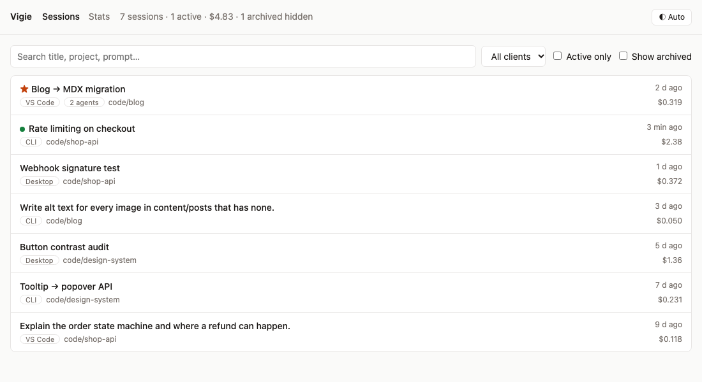
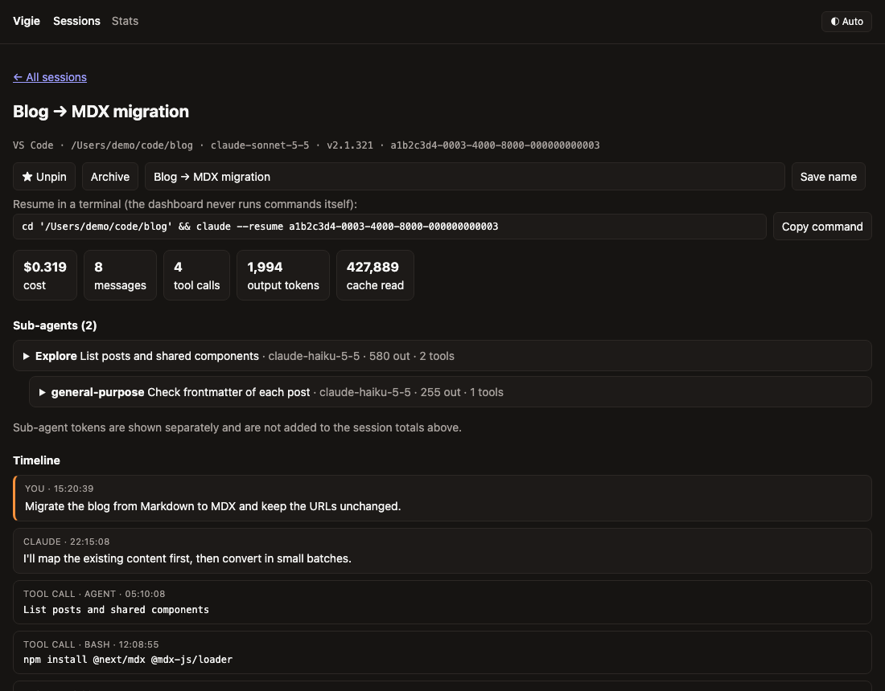
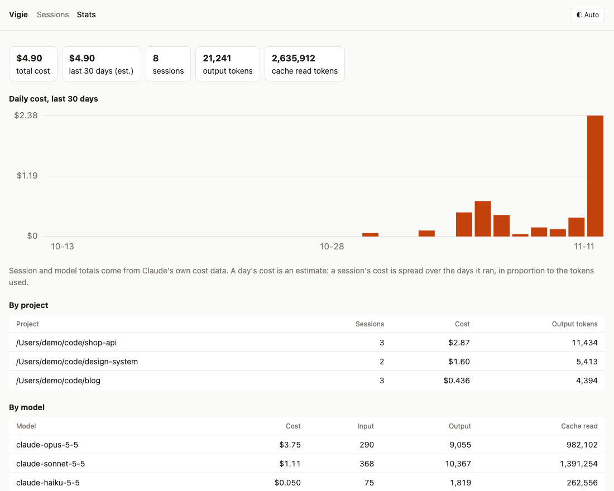

# Vigie

A lightweight, **local-only** dashboard for your **Claude Code** sessions: browse them, see what they cost and which sub-agents they spawned.

It reads the transcripts Claude Code writes in `~/.claude`, whichever client started the session. So far it has only been tested with sessions started from the Claude desktop app (Code tab). CLI and VS Code sessions use the same files and should show up too, but that is not verified yet.

Read-only by design: it never modifies your Claude files and never runs anything on your behalf.

## Screenshots

Made-up demo data (`npm run demo`), not real sessions.







## Install

Requires Node.js 22.18 or newer. Not published on npm (yet): install from GitHub.

```bash
npx github:vinsliu/vigie
# → http://127.0.0.1:4317
```

Or from a clone:

```bash
git clone https://github.com/vinsliu/vigie && cd vigie
npm install && npm start
```

## Scope

- **Local only.** It reads the session files Claude already writes in `~/.claude` (or `$CLAUDE_CONFIG_DIR`). No account, no cloud, no telemetry, no outgoing request.
- **Claude Code only.** Cowork sessions (the desktop app keeps them elsewhere, in another format) and claude.ai chat conversations are not read.
- A session only shows up while its transcript still exists in `~/.claude`: if Claude has deleted it, it is gone from Vigie too.
- Remote sessions (Claude Code on the web, other machines, SSH hosts) are out of scope. Each machine has its own view.
- **Never modifies Claude's files.** Pins and display names are stored in the dashboard's own file (`~/.config/vigie/meta.json`, or `--data-dir`). Renaming here does not rename the session in Claude.
- **Never runs commands.** "Resume" only gives you a command to copy and run yourself.

## Features (MVP)

- Session list: project, client (desktop / CLI / VS Code), title, last activity, cost, live status.
- Session detail: timeline of messages and tool calls, token totals.
- Sub-agents: tree of the agents a session spawned (nested ones included), each with its own timeline loaded on demand. Their tokens are shown separately and are not added to the session totals.
- Stats: total cost, daily cost chart (last 30 days), breakdown by project and by model.
- Management: pin a session, archive it (hide it from the list, reversible, nothing is moved or deleted; archived sessions still count in the Stats), give it a display name, copy the command that resumes it (`cd <project> && claude --resume <id>`, POSIX shells).
- Live refresh through Server-Sent Events.

> Costs per session, project and model come straight from Claude's own cost data. The cost of a given *day* is an estimate: a session's cost is spread over the days it ran, in proportion to the tokens used.

## Design goals

- **Light**: zero runtime dependencies, no database, no front-end build step. The JSONL transcripts stay the single source of truth.
- **Cheap on big files**: the list only reads the head and tail of each transcript; a full transcript is streamed only when you open it.
- **Secrets masked (best effort)**: API keys, tokens, JWTs, private keys, `Authorization` headers, `user:password@` URLs and `NAME=value` secrets are replaced by `[redacted]` before text reaches the browser. It is a safety net for screenshots and screen sharing, not a guarantee: a secret in an unusual format is shown as is.
- **Private**: the server binds to `127.0.0.1` only and rejects any request whose `Host` header is not local (DNS-rebinding protection). Transcripts are rendered as plain text, never as HTML. The only write endpoint (pin / display name) requires a JSON content type and a same-origin request, and accepts at most 4 KB.

## Development

Requires Node.js 22.18 or newer (native TypeScript execution).

```bash
npm install
npm start          # run from sources
npm test           # node:test with anonymised fixtures
npm run typecheck
npm run build      # emits dist/ for publishing
npm run demo       # serve made-up sessions on :4318 (never reads ~/.claude)
```

See [CONTRIBUTING.md](CONTRIBUTING.md) before opening a pull request.

Options: `--port <n>` (default `4317`), `--claude-dir <path>`, `--data-dir <path>`.

## Layout

```
src/core/    JSONL parsing, session index, live process detection
src/server/  HTTP API, SSE, host guard
ui/          static HTML / CSS / vanilla JS
test/        tests and fixtures
scripts/     made-up demo data generator (`npm run demo`)
docs/        screenshots
```

## Disclaimer

The transcript format is not a documented public API and may change between Claude versions. The parser is deliberately tolerant and ignores unknown records.

## License

MIT
